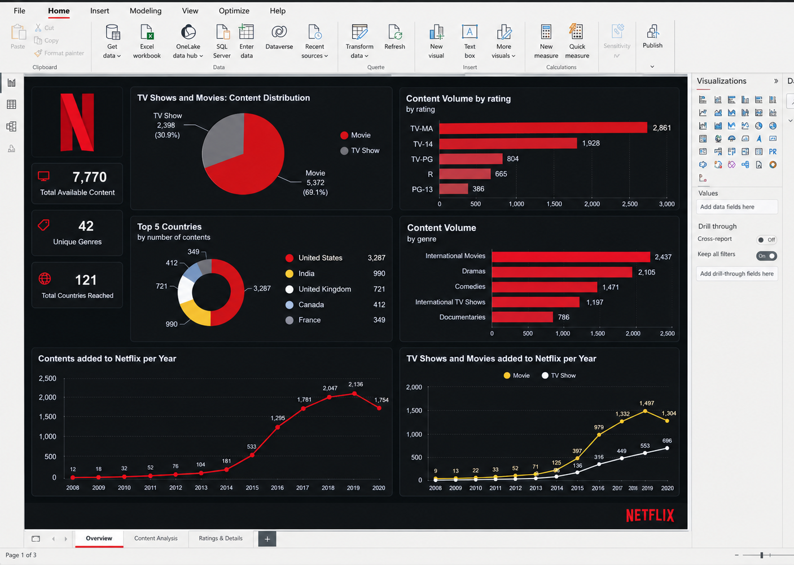
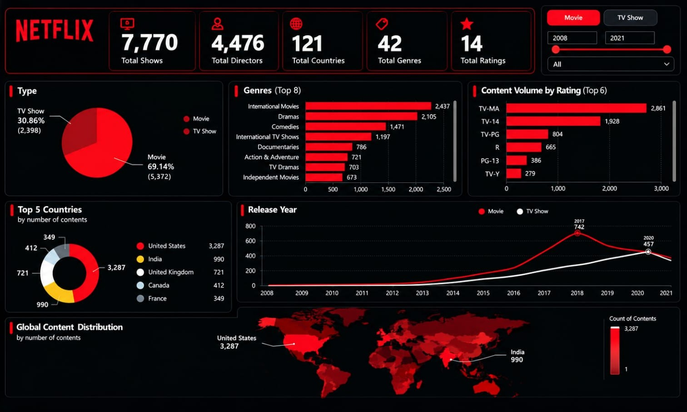

# 🎬 Netflix Content Strategy & Analytics - Final Case Study

**Final Data Analytics Project for the SWYNEX Technologies Virtual Internship.**

---

## 📌 1. Project Overview & Problem Statement
The streaming industry is highly competitive, requiring platforms like Netflix to continuously analyze their content catalog to optimize acquisition strategies and maintain global subscriber engagement.

The goal of this project is to perform an end-to-end data analytics case study on the Netflix catalog. Using **Python (Pandas, Matplotlib, Seaborn)** for data cleaning and EDA, along with **Power BI** for interactive visualizations, this study uncovers critical trends in content distribution, geographical reach, target audience demographics, and chronological growth.

---

## 📊 2. Dataset Information
* **Source:** Kaggle (Netflix Movies and TV Shows Dataset)
* **Total Records:** 7,770 titles across 12 attributes (after cleaning).
* **Key Columns:** `show_id`, `type` (Movie/TV Show), `title`, `director`, `cast`, `country`, `date_added`, `release_year`, `rating`, `duration`, `genres`.

---

## 🧹 3. Data Cleaning & Preparation
Data preprocessing was conducted using **Python (Pandas)** to ensure data accuracy and readiness for analysis:
1. **Duplicate Removal:** Checked and dropped duplicate rows to preserve data integrity.
2. **Handling Null Values:** 
   * Replaced missing text values in `director`, `cast`, and `country` with `'Unknown'`.
   * Dropped rows missing critical datetime information (`date_added`).
3. **Data Type Conversion:** Standardized string date entries into proper Python `DateTime` formats for time-series evaluation.

---

## 📈 4. Exploratory Data Analysis (EDA)
Using **Matplotlib** and **Seaborn**, exploratory data analysis was conducted to uncover initial statistical distributions:
* Evaluated the distinct volume split between Movies and TV Shows.
* Identified historical release year trends and catalog expansion velocity.
* Analyzed top content-producing nations and audience rating classifications.

---

## 🖥️ 5. Interactive Dashboards (Power BI)

An interactive, dark-themed Power BI dashboard suite was developed to communicate findings effectively.

### 📌 Dashboard 1: Content Distribution & Trend Overview

### 📌 Dashboard 2: Global Reach & Audience Demographics

### 📌 Dashboard 3: Release Trends & Top Countries Treemap

---

## 💡 6. Key Business Insights
Based on the comprehensive analysis, here are the top 5 strategic findings:

1. **Movie Dominance:** Movies make up **69.14%** (5,372 titles) of the catalog compared to **30.86%** (2,398 titles) for TV Shows.
2. **Top Geographical Markets:** The **United States** (3,287 titles) and **India** (990 titles) are the leading producers of content, highlighting India's critical strategic role in international content expansion.
3. **Mature Demographic Focus:** Over **60%** of the content library is rated **TV-MA** (2,861 titles) and **TV-14** (1,928 titles), indicating a strong strategic focus on mature and young-adult demographics.
4. **Acquisition Spike (2017–2019):** Content acquisition experienced a massive boom between 2017 and 2019 (peaking at 2,136 additions in 2019), followed by stabilization in 2020/2021.
5. **Genre Saturation:** **International Movies (2,437)**, **Dramas (2,105)**, and **Comedies (1,471)** represent the highest volume of content, reinforcing Netflix's narrative-driven global approach.

---

## 🛠️ 7. Tools & Technologies Used
* **Programming Language:** Python
* **Data Processing:** Pandas, NumPy
* **Data Visualization:** Matplotlib, Seaborn
* **Business Intelligence (BI):** Microsoft Power BI
* **Environment:** Google Colab, Power BI Desktop

---

## 📁 8. Repository Structure
